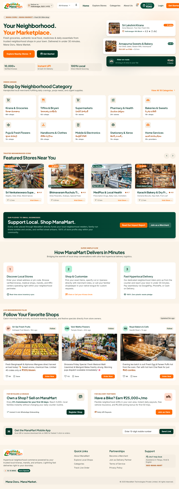
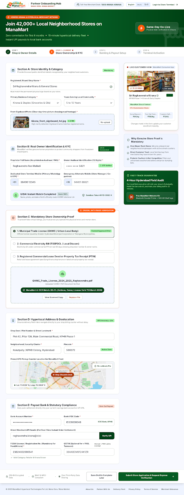
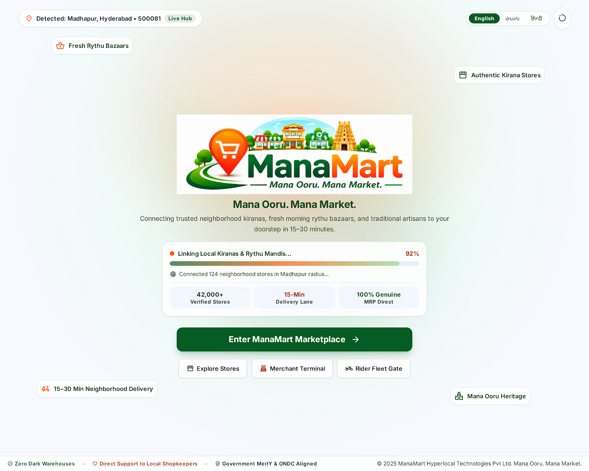
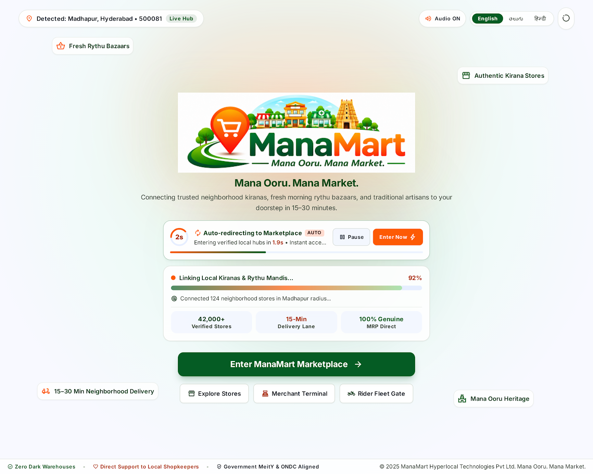
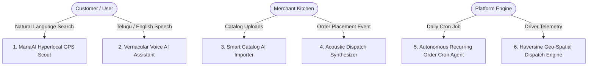
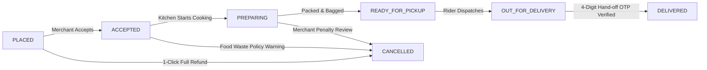

# 🛒 ManaMart — Mana Ooru. Mana Market.
### *Your Entire Neighborhood, Delivered.* (Powered by LocalLoop)

[](https://manamart-o409.onrender.com)
[](https://github.com/jyoshnapramodat-crypto/ManaMart)
[](https://react.dev/)
[](https://vitejs.dev/)
[](https://nodejs.org/)
[](https://www.mongodb.com/)
[](https://tailwindcss.com/)
[](https://socket.io/)
[](#)

---

## 🌐 Live Production Application
🚀 **ManaMart is deployed and live in production:**  
👉 **[https://manamart-o409.onrender.com](https://manamart-o409.onrender.com)**

> [!TIP]
> **Unified Access**: Explore every user context (Customer, Merchant Kitchen, Delivery Partner, or Platform Administrator) seamlessly via the **Unified Identity Portal** at `/login` with pre-filled test profiles and instant 6-digit OTP verification.

---

## 📸 Application Architecture & Visual Tour

| 🌟 **Customer Marketplace & Smart Search** | 🛵 **Delivery Hero (Rider) Command Console** |
| :---: | :---: |
|  |  |
| *Bilingual search, category grids, flash offers, stories & cart drawer* | *Duty toggle (Online/Offline), active trip card, telemetry & dispatch tasks* |

| 🍳 **Merchant Hub & Kitchen KOT Stream** | 🔐 **Unified Login & Live OTP Security Gate** |
| :---: | :---: |
|  |  |
| *Live incoming order stream, prep timers, acoustic alert toggle & settlements* | *4-Role selector deck, pre-filled OTP node (`482915`), and session gateway* |

---

## 🌟 Executive Vision & Hyperlocal Ecosystem

**ManaMart** (powered by the **LocalLoop** platform) is an enterprise-grade, mobile-first hyperlocal community commerce and multi-vendor delivery platform engineered to connect neighborhood shops, authentic regional kitchens, kirana grocers, pharmacies, bakeries, and delivery riders across Indian towns and metropolitan clusters (Hyderabad, Madhapur, Gachibowli, Guntur, Vijayawada, Vizag).

### The Four Isolated User Portals:
1. **Customer Marketplace (`/`, `/app`, `/search`, `/store/:id`)**:
   - Location-aware storefront discovery (0–10 km radius using Haversine spherical geometry).
   - Multi-category cart with transparent pricing, taxes, packaging, and distance delivery fees.
   - Live turn-by-turn order tracking with animated GPS radar and delivery OTP.
   - Dine-in table reservations with digital QR entry passes and celebratory confetti.
2. **Merchant Hub (`/merchant/*`)**:
   - Live Kitchen Order Ticket (KOT) stream with 1-click status transitions (`PREPARING`, `READY_FOR_PICKUP`).
   - Acoustic kitchen order chime with opt-in volume controls to prevent CPU audio node congestion.
   - Story publisher with live customer preview modal for broadcasting specials and discounts.
   - Bulk CSV/Excel catalog importer with live validation and error checking.
   - Financial ledger tracking daily GMV, commissions, TDS deductions, and instant UPI payouts.
3. **Delivery Hero (Rider) Console (`/rider/*`)**:
   - Dedicated mobile-first telemetry shell with real-time GPS beacon (`1.2m accuracy`), hardware battery reader (`86% (68 km)`), and COD cash-in-hand counter (`₹620`).
   - Dual-state operational console:
     - **Online Duty**: Live trip card (`#MM-8942`, Express 15m SLA), dispatch task queue (`Sri Lakshmi Kirana`, `Subbayya Gari Hotel`, `Apollo Pharmacy`), daily streak targets, and surge heatmap radar (`+₹20/order`).
     - **Offline Duty**: Shift paused safety checklist (battery, bag, cash verification) and muted queue preview.
     - Sticky thumb-zone 4-cell delivery hand-off OTP verification input (`/rider/active-trip`).
     - Emergency SOS modal with one-tap 112/100 police dialer and breakdown assistance.
     - Scannable Remittance Hub QR modal for depositing cash-in-hand at local hubs.
4. **Admin Governance Center (`/admin/*`)**:
   - City-level GMV, total transaction volume, active rider counts, and commission metrics.
   - Two-column compliance verification pipelines for pending Merchant FSSAI/PAN and Rider Driving Licenses.
   - Automated dispute triage routing low-rating customer reviews ($\le 2$ stars) directly to arbitration.
   - Secure non-public administrative team onboarding with expiring signed JWT invitation links.

---

## 🧠 Autonomous AI Agents & Intelligent Systems



### 1. ManaAI Hyperlocal GPS Scout (`ManaAIScout.jsx`)
* Reads live browser geolocation coordinates and resolves reverse-geocoded neighborhood names.
* Parses natural language customer intent (e.g., *"craving biryani for dinner"*, *"emergency fever medicine"*, *"monthly grocery staples"*).
* Evaluates nearby stores against delivery SLA, distance radius, and FSSAI hygiene ratings, generating real-time contextual explanations.

### 2. Vernacular Voice AI Assistant (`VernacularVoiceModal.jsx`)
* Real-time bilingual speech recognition in **Telugu (`te-IN`)** and **Indian English (`en-IN`)**.
* NLU entity extractor detecting item quantities and regional Telugu dish names (e.g., *"రెండు ప్యాకెట్లు పాలు"*, *"హండీ చికెన్ దమ్ బిర్యానీ"*).
* Directly parses speech input and injects items into the customer shopping cart.

### 3. Autonomous Recurring Order Cron Agent (`recurringScheduler.js`)
* Background automated subscription agent powered by `node-cron`.
* Evaluates active customer recurring baskets (daily milk, fresh bread, monthly ration) and auto-generates orders at scheduled intervals without requiring manual checkout.

### 4. Acoustic Dispatch Synthesizer (`soundService.js`)
* Synthesizes mathematical dual-tone audio frequencies directly in the browser via the **Web Audio API** (C5 523Hz + E5 659Hz marimba chords, 740Hz rider chirps).
* Eliminates heavy MP3/WAV audio assets and cuts through loud kitchen environments.

### 5. Haversine Geo-Spatial Dispatch Engine (`haversine.js`)
* High-precision spherical distance routing between customer coordinates, merchant locations, and active delivery partners.
* Dynamically computes delivery fee tiers and ETA countdowns (15 min SLA for $<1.5\text{ km}$, 25 min for $<4\text{ km}$).

---

## 🔄 Robust Order State Machine & Cancellation Engine



### Cancellation Policies:
* **`PLACED`**: Customer or Merchant can cancel with 1-click for an instant 100% refund.
* **`PREPARING` and beyond**: Cancellation warning displayed explaining food waste compensation policy; merchant is compensated for prepared items.
* **`OUT_FOR_DELIVERY`**: Customer cancellation is locked on client; triggers direct "Report Issue / Call Support" arbitration workflow.
* **Real-Time Synchronization**: All cancellations and transitions broadcast instantly to Merchant, Rider, and Customer via Socket.IO rooms.

### Two-Tier Post-Delivery Review Flow:
Once an order reaches **`DELIVERED`**, the customer view unlocks a split 2-tier review modal:
1. **Store & Product Quality**: 1–5 stars, tag chips (*"Fresh"*, *"Well Packaged"*, *"Wrong Item"*), and textual review.
2. **Delivery Partner Experience**: 1–5 stars, delivery behavior feedback, and optional UPI rider tip.
3. **Auto-Dispute Triage**: Any rating $\le 2$ stars automatically dispatches an escalation ticket to `/admin/disputes`.

---

## 🔐 Authentication, Route Guards & Security Hardening

* **Strict Role Barriers (`ProtectedRoute.jsx`)**: Non-customer portals strictly reject unauthorized cross-role access. Unauthenticated users are redirected to `/login`, while unauthorized roles are redirected to their designated dashboard.
* **Unified Identity Portal (`LoginPage.jsx`)**: Clean 4-role selection deck, pre-filled demonstration accounts, live password visibility toggling, and 6-digit live OTP security node (`482915`).
* **Non-Public Admin Architecture**:
  - NO public admin registration URL exists.
  - Initial Super Admin is seeded via backend CLI:
    ```bash
    npm run create-admin -- --email admin@manamart.in --password StrongPassword123! --name "Admin Chief"
    ```
  - Subsequent admins can only register via expiring signed JWT invite links generated in `/admin/team` and accepted at `/admin/accept-invite?token=...`.

---

## ☁️ Cloud Deployment Resilience & MongoDB Atlas Connectivity

The backend database connector ([`server/src/config/db.js`](file:///c:/Users/jyosh/ManaMart/server/src/config/db.js)) is engineered for cloud hosting environments (Render, Railway, Heroku, Docker):

1. **Immediate Port Binding**: `server.listen(PORT)` starts synchronously before database checks, preventing cloud hosting health-check timeouts and container restart loops.
2. **Cloud Detection**: Inspects `process.env.RENDER`, `process.env.NODE_ENV`, and checks multiple environment variable names (`MONGODB_URI`, `MONGODB_ATLAS_URI`, `MONGO_URL`, `DATABASE_URL`).
3. **Safe Hybrid Standalone Fallback**: If running on Render before an Atlas URI is configured, or if credentials fail authentication, the server **never crashes**. It automatically enables the in-memory fallback store, logs clear setup instructions, and keeps the service **100% online**.
4. **Resilient Health Check (`/api/health`)**: Always returns HTTP `200 OK` with database status metadata so cloud load balancers recognize the deployment as healthy.

---

## 🛠️ Technology Stack Breakdown

| Category | Technologies & Frameworks |
| :--- | :--- |
| **Frontend Framework** | **React 18.2** (Single Page Application, Vite 5.4 build toolchain) |
| **Styling & Design** | **Tailwind CSS v3.4**, **PostCSS**, **Lucide React** (iconography), **Framer Motion** |
| **State & Localization** | React Context API (`AuthContext`, `CartContext`, `LocationContext`, `ThemeContext`), **i18next** (English & Telugu bilingual dictionary) |
| **Backend Framework** | **Node.js** (v18–v24, ES Modules), **Express.js v4**, RESTful API architecture |
| **Databases** | **MongoDB Atlas** (Cloud ReplicaSet) + **Mongoose ODM v8** with GeoJSON `2dsphere` spatial indexing + In-memory standalone store |
| **Real-Time WebSockets** | **Socket.IO** (bi-directional events for order status, kitchen alerts, and live rider GPS coordinates) |
| **Audio Synthesizer** | **Web Audio API** (native hardware-free dual-tone oscillators) |
| **Security & Auth** | **JWT** (`jsonwebtoken`), **bcryptjs**, OTP Security Node, signed administrative invitation tokens |
| **Scheduled Tasks** | **node-cron** (automated recurring shopping list engine) |

---

## 📂 Project Directory Structure

```text
ManaMart/
├── client/
│   ├── src/
│   │   ├── components/
│   │   │   ├── admin/AdminPortalLayout.jsx         # Isolated Admin Governance Shell
│   │   │   ├── merchant/MerchantPortalLayout.jsx   # Isolated Merchant Shell & Kitchen Bell
│   │   │   ├── rider/RiderPortalLayout.jsx         # Isolated Delivery Hero Shell & Telemetry
│   │   │   ├── Navbar.jsx                          # Customer Header (Desktop)
│   │   │   ├── BottomNav.jsx                       # Customer 5-Tab Dock (Mobile)
│   │   │   ├── CartDrawer.jsx                      # Slide-out Cart with Multi-Item Stepper
│   │   │   ├── LiveGpsRadarMap.jsx                 # Vector Bezier Turn-by-Turn GPS Map
│   │   │   ├── ManaAIScout.jsx                     # AI Hyperlocal GPS Neighborhood Scout
│   │   │   ├── TableReservationModal.jsx           # Dine-In Booking with Table Selector
│   │   │   ├── VernacularVoiceModal.jsx            # Bilingual Telugu/English Voice Ordering
│   │   │   ├── MerchantBulkImporterModal.jsx       # CSV/Excel Catalog Batch Ingestor
│   │   │   └── ProtectedRoute.jsx                  # Strict Role & Compliance Route Barrier
│   │   ├── context/
│   │   │   ├── AuthContext.jsx                     # Sessions, Profiles & OTP State
│   │   │   ├── CartContext.jsx                     # Multi-Store Cart & Checkout Staging
│   │   │   ├── LocationContext.jsx                 # GPS Tracking & Neighborhood Selection
│   │   │   └── ThemeContext.jsx                    # Dark / Light Theme Switching
│   │   ├── locales/
│   │   │   ├── en.json                             # English Language Dictionary
│   │   │   ├── te.json                             # Telugu (తెలుగు) Language Dictionary
│   │   │   └── i18n.js                             # i18next Configuration
│   │   ├── pages/
│   │   │   ├── auth/LoginPage.jsx                  # Unified 4-Role Identity & OTP Portal
│   │   │   ├── auth/SignupPage.jsx                 # Customer Registration Form
│   │   │   ├── customer/HomePage.jsx               # Hyperlocal Showcase & Category Grids
│   │   │   ├── customer/MerchantDetailsPage.jsx    # Store Catalog, Add-to-Cart & Reviews
│   │   │   ├── customer/OrderTrackingPage.jsx      # Order State Machine & Review Card
│   │   │   ├── customer/RecurringListsPage.jsx     # Automated Monthly Subscription Builder
│   │   │   ├── merchant/MerchantDashboardView.jsx  # Live KOT Kitchen Stream & Story Publisher
│   │   │   ├── merchant/MerchantMenuView.jsx       # Catalog Management & Stock Toggles
│   │   │   ├── merchant/MerchantFinanceView.jsx    # GMV Ledger & Settlement Requests
│   │   │   ├── rider/RiderDashboardView.jsx        # Online/Offline Console & Dispatch Queue
│   │   │   ├── rider/RiderActiveTripView.jsx       # Navigation Trigger & 4-Cell Delivery OTP
│   │   │   ├── rider/RiderEarningsView.jsx         # Daily Earnings & UPI Payout Summary
│   │   │   ├── admin/AdminVerificationsView.jsx    # Merchant FSSAI & Rider License Auditing
│   │   │   ├── admin/AdminDisputesView.jsx         # Review Arbitration Queue (<= 2 stars)
│   │   │   └── admin/AdminTeamView.jsx             # Admin Management & Signed JWT Invites
│   │   ├── services/
│   │   │   ├── api.js                              # Axios HTTP Client with Interceptors
│   │   │   ├── socket.js                           # Socket.IO Client Singleton
│   │   │   └── soundService.js                     # Web Audio API Synthesizer Engine
│   │   ├── utils/pincodeLookup.js                  # Instant Pincode & Locality Dictionary
│   │   ├── App.jsx                                 # Master Router & Portal Decoupling
│   │   ├── index.css                               # Tailwind Directives & Radar Keyframes
│   │   └── main.jsx                                # React 18 Entrypoint
│   ├── tailwind.config.js                          # Forest Jade & Saffron Color System
│   └── vite.config.js                              # Vite Bundler Configuration
├── server/
│   ├── src/
│   │   ├── config/
│   │   │   ├── db.js                               # Resilient MongoDB Atlas / Compass Connector
│   │   │   └── jwt.js                              # Signed Token Generation & Verification
│   │   ├── controllers/
│   │   │   ├── authController.js                   # Login, OTP Dispatch & Profile Routing
│   │   │   ├── orderController.js                  # State Machine, Cancellation & Review Logic
│   │   │   ├── merchantController.js               # KOT Stream, Menu CRUD & Story Posts
│   │   │   ├── riderController.js                  # Duty Toggle, Delivery Assignment & OTP
│   │   │   ├── adminController.js                  # KYC Approval Pipelines & Dispute Triage
│   │   │   └── discoveryController.js              # Haversine Proximity Store Discovery
│   │   ├── models/
│   │   │   ├── Order.js                            # Order, Items, Refund & Review Schema
│   │   │   ├── Store.js                            # Merchant Business & FSSAI Profile Schema
│   │   │   ├── User.js                             # Multi-Role User Profile Schema
│   │   │   ├── Product.js                          # Catalog Item & Category Schema
│   │   │   └── Review.js                           # Two-Tier Store & Rider Rating Schema
│   │   ├── routes/                                 # Modular Express Routers (/api/v1/...)
│   │   ├── sockets/socketHandler.js                # Real-time WebSocket Event Dispatcher
│   │   ├── jobs/recurringScheduler.js              # Cron Subscription Shopping Agent
│   │   ├── utils/
│   │   │   ├── haversine.js                        # Spherical Distance Geo Calculations
│   │   │   ├── otpGenerator.js                     # Secure 6-Digit Verification Code Generator
│   │   │   ├── mockDbStore.js                      # High-Fidelity In-Memory Fallback Dataset
│   │   │   └── seedData.js                         # Database Seeder for Regional Stores
│   │   └── app.js                                  # Express Middleware & Static Dist Server
│   ├── server.js                                   # HTTP & Socket.IO Listener Entrypoint
│   └── .env                                        # Environment Variables
├── scripts/create-admin.js                         # CLI Script for Secure Admin Seeding
├── server.js                                       # Root Entrypoint for Render / Cloud Deploys
└── package.json                                    # Monorepo Build & Start Scripts
```

---

## 🚀 Quick Start & Local Setup

### Prerequisites
* **Node.js** v18+ (tested on Node v20 / v24)
* **npm** v9+
* *(Optional)* MongoDB Atlas account or local MongoDB Compass instance

### 1. Clone & Install Dependencies
```bash
git clone https://github.com/jyoshnapramodat-crypto/ManaMart.git
cd ManaMart

# Install root, backend, and frontend packages in a single command
npm run install:all
```

### 2. Environment Configuration
Create or configure `server/.env` (or pass environment variables directly in your cloud dashboard):
```env
PORT=5050
NODE_ENV=development
CLIENT_URL=http://localhost:5173

# MongoDB Atlas (mongodb+srv://) or local MongoDB Compass
MONGODB_URI=mongodb+srv://<username>:<password>@cluster0.xxxxx.mongodb.net/localloop_manamart?retryWrites=true&w=majority

# JWT Authentication
JWT_SECRET=super_secret_jwt_key_localloop_2026_dev
JWT_EXPIRES_IN=7d
REFRESH_TOKEN_SECRET=super_secret_refresh_jwt_key_localloop_2026_dev
REFRESH_TOKEN_EXPIRES_IN=30d
```

### 3. Seed Demonstration Data (Optional)
```bash
npm run seed --prefix server
```

### 4. Run Development Servers
```bash
# Starts Express REST API + Socket.IO and Vite React frontend concurrently
npm run dev
```

* **Frontend Application**: `http://localhost:5173`
* **Backend REST API**: `http://localhost:5050/api/v1`
* **Health Check & DB Status**: `http://localhost:5050/api/health`

### 5. Production Build
```bash
npm run build
npm start
```

---

## 🧪 Testing Multi-Role Workflows

Visit `/login` and test each tailored experience directly:

1. **Customer Experience**:
   - Select **Customer** $\rightarrow$ Click **Confirm & Enter Dashboard** (or use OTP `482915`).
   - Try the **ManaAI GPS Scout** or **Telugu Voice Ordering** (*"రెండు బిర్యానీలు"*).
   - Reserve a restaurant table or place an order to test live GPS radar tracking and cancellation refunds.
2. **Merchant Kitchen Experience**:
   - Select **Merchant / Shop** $\rightarrow$ Click **Confirm & Enter Dashboard**.
   - Manage incoming orders on the live KOT board, test the acoustic kitchen alert, and publish a new story post with live customer preview.
3. **Delivery Hero Experience**:
   - Select **Delivery Partner** $\rightarrow$ Click **Confirm & Enter Dashboard**.
   - Toggle **Online / Offline Duty**, inspect vehicle battery telemetry (`86%`), view nearby dispatch tasks, and complete the active trip via 4-cell PIN OTP verification.
4. **Administrator Experience**:
   - Select **Administrator** $\rightarrow$ Enter governance console.
   - Audit submitted merchant FSSAI certificates, review rider driving licenses, triage dispute complaints ($\le 2$ stars), and generate expiring signed admin invite links.

---

## 🇮🇳 Regional Identity & Tagline
> **మన ఊరు. మన మార్కెట్. మీ పరిసరాలు, మీ ఇంటికే.**  
> *Mana Ooru. Mana Market. Your Entire Neighborhood, Delivered.*
