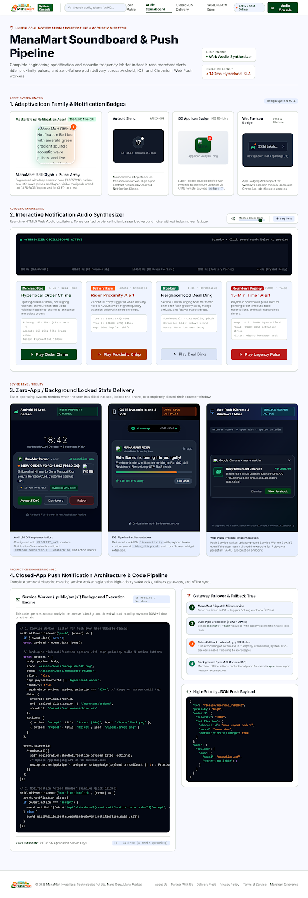

# 🛒 ManaMart — Mana Ooru. Mana Market.
### *Your Entire Neighborhood, Delivered.* (Powered by LocalLoop)

[](https://manamart-o409.onrender.com)
[](https://github.com/jyoshnapramodat-crypto/ManaMart)
[](https://react.dev/)
[](https://vitejs.dev/)
[](https://nodejs.org/)
[](https://www.mongodb.com/)
[](https://tailwindcss.com/)
[](https://socket.io/)
[](#)

---

## 🌐 Live Production Application
🚀 **ManaMart is live in production! Visit the live deployment:**  
👉 **[https://manamart-o409.onrender.com](https://manamart-o409.onrender.com)**

> [!TIP]
> **Zero-Friction Demo Testing**: You can explore every capability (Customer, Restaurant Owner, Delivery Rider, or Platform Admin) instantly using the **Quick Role Switcher** or the **1-Click Demo Buttons** on the Sign-In page without having to register or verify external credentials.

---

## 📸 Application Screenshots & Visual Tour

| 🌟 **Marketplace Overview & Clean Two-Tier Header** | 🚀 **ManaMart Brand Portal & Splash Experience** |
| :---: | :---: |
|  |  |
| *Spacious search bar, Telugu/English switcher, category filters & local stories* | *2-second welcoming splash screen with instant town & locality discovery* |

| 🗺️ **Live GPS Radar & Turn-by-Turn Order Tracking** | 🍽️ **Restaurant Menu & Dish Customizations** |
| :---: | :---: |
|  |  |
| *Vector road Bezier routing, animated sonar radar, speedometer & delivery OTP* | *Authentic regional Telugu dishes, portion sizes, spice meters & add-to-cart* |

| 🏪 **Hyperlocal Store Discovery Grid** | 🔔 **Real-Time Notification Center & Audio Soundboard** |
| :---: | :---: |
|  |  |
| *Verified neighborhood kirana, restaurants, bakeries & pharmacies with FSSAI badges* | *WebSocket live alerts from followed shops with Web Audio API synthesizer* |

| 📱 **Mobile-First Responsive Experience** |
| :---: |
|  |
| *High-speed responsive PWA layout designed specifically for Indian tier-2/3 smartphones* |

---

## 🌟 Executive Vision

**ManaMart** (powered by the **LocalLoop** platform) is a production-grade, mobile-first hyperlocal commerce and delivery platform specifically architected to empower neighborhood shops, restaurants, kirana stores, pharmacies, bakeries, and local services in Indian towns and tier-2/3 cities.

Combining the best paradigms of modern hyperlocal apps:
- **Swiggy & Zomato**: Food discovery, appetizing menus, dish customizations, and **BookMyShow-style restaurant table reservations**.
- **Blinkit & Instamart**: Express 15-minute essentials, multi-store smart cart, and stock substitution preferences.
- **Rapido**: Independent delivery partner assignment, turn-by-turn route tracking, and **Live GPS Radar map**.
- **Instagram & YouTube**: Store updates, merchant story rings, flash discounts, new arrival feeds, and subscription channels.
- **Vernacular AI**: Bilingual voice ordering in **Telugu (తెలుగు)** and **Indian English** with zero-latency speech recognition and entity extraction.

---

## 🚀 Key Feature Highlights

### 1. 🍽️ Dine-In Table Reservations & Fake Mailbox System
- **Interactive Table & Seating Selector**: Choose from AC Fine Dining Halls, Rooftop Sky Lounges, or Private Royal Cabins with visual table layouts (`T-01` to `T-08`).
- **Simulated Email & OTP Verification Gateway**: Secure 6-digit numeric OTP with 5-minute expiry timestamp.
- **Dev Fake Mailbox Drawer**: Global floating development mailbox that intercepts incoming emails in real-time, displays formatted email bodies, and offers **1-Click OTP Auto-Fill**.
- **Digital QR Entry Pass**: Confirmed bookings generate a branded digital entry ticket with a scannable QR pass, party size, and table assignment.
- **Smart Auth Guard**: Unauthenticated guests clicking "Book Restaurant" are guided to sign in with an informative banner; 1-click test login returns them directly to their booking flow.

### 2. 🗺️ Live Interactive GPS Map & Rider Radar
- **Turn-by-Turn Bezier Routing**: Vector road route visualization with animated cubic bezier curves connecting the merchant, live rider, and customer doorstep.
- **Sonar Radar & Moving Scooter Pin**: Real-time scooter icon with animated sonar radar rings.
- **Live Telemetry Dashboard**: Real-time speedometer (`28 km/h`), distance meter (`420m remaining`), and ETA countdown.
- **Dual Layer Toggle**: One-click switch between **Dark Vector Street Mode** and **High-Res Satellite View**, with fullscreen capability and direct rider phone dialing.

### 3. 🎙️ Vernacular Voice AI Ordering (Telugu + English)
- **Bilingual Web Speech Recognition**: High-accuracy natural speech understanding in Telugu (`te-IN`) and Indian English (`en-IN`).
- **NLU Entity Extraction**: Understands spoken quantities and items (e.g., *"రెండు ప్యాకెట్లు బియ్యం"*, *"హండీ చికెన్ దమ్ బిర్యానీ"*, *"2 bags Sona Masoori Rice"*, *"1 strip Dolo 650"*).
- **Audio Waveform Visualizer & Web Audio Chimes**: Live pulsing waveform visualizer backed by zero-external-file Web Audio API synthesizer.
- **1-Tap Test Prompts**: Test voice ordering immediately in quiet rooms or on devices without physical microphones by tapping sample Telugu/English phrases.
- **Direct Cart Injection**: Automatically adds parsed items with quantity into `useCart()` and opens the checkout drawer.

### 4. 📊 Merchant Bulk CSV/Excel Catalog Importer
- **1-Click Template Generator**: Download `ManaMart_Catalog_Template.csv` pre-populated with Telugu dish names, categories, MRP, selling price, and stock counts.
- **Live Catalog Export**: Merchants can backup or export their entire live menu to CSV.
- **Drag-and-Drop Parser & Validation**: Real-time row parser with margin analysis, veg/non-veg status, and batch insertion directly into the merchant dashboard inventory.

### 5. 🧭 Clean Two-Tier Desktop Navigation Architecture
- **Tier 1 (Main Header)**: Spacious, uncrowded search bar with 500px+ width, location selector, vernacular voice mic trigger, language toggle, notifications, and auth/cart buttons.
- **Tier 2 (Services Ribbon)**: Clean secondary utility strip directly beneath the search bar featuring quick links to *Dine-In Booking*, *Updates & Feed*, *Monthly Auto-Lists*, *Parcel Courier*, and *Local Services*.

### 6. 🔊 Native Web Audio Synthesizer (Zero External Audio Files)
- Uses the browser's native **Web Audio API** oscillators to generate acoustic notifications:
  - 🔔 *Order Chime*: Dual harmonic chime for order placed/received.
  - 🛵 *Rider Chirp*: High-frequency ping for courier pickup/arrival.
  - 🎉 *Deal Ding*: Resonant bell for applied coupons and discounts.

### 7. 🗄️ MongoDB Integration & Resilient In-Memory Fallback
- Production Mongoose schemas for `User`, `Store`, `Product`, `Reservation`, and `Order` with GeoJSON `2dsphere` spatial indexing.
- Comprehensive database seeder (`npm run seed --prefix server`) pre-populating verified stores (Swagath Grand, Annapurna Supermarket, Niloufer Cafe, Apollo Pharmacy) with Telugu labels.
- Resilient in-memory fallback allowing the entire system to run seamlessly even when MongoDB is offline.

---

## 🛠️ Technology Stack

| Layer | Technologies |
|---|---|
| **Frontend** | React 18, Vite 5.4, Tailwind CSS v3.4, Lucide Icons, Canvas Confetti, Web Speech API, Web Audio API, Axios, React Router DOM v6, React-i18next (English & Telugu) |
| **Backend** | Node.js, Express.js, RESTful API (`/api/v1`), Socket.IO (WebSocket real-time engine), JWT Authentication (Access + Refresh tokens), Node-Cron, UUID, Morgan |
| **Database** | MongoDB 8.2 / Mongoose ODM with GeoJSON `2dsphere` indexing + Hybrid in-memory store fallback |
| **Payments** | Razorpay checkout flow (UPI, Cards, Net Banking, COD) with backend verification handshakes |
| **Simulated Services** | In-Memory / LocalStorage Fake Mailbox with OTP auto-fill & notification listener |

---

## 👥 User Roles & 1-Click Test Accounts

ManaMart includes a **Quick Role Switcher Toolbar** and **1-Click Test Accounts** on the login page so you can test every workflow without using personal information:

1. **Customer (`ravi.kumar@example.com` / `password123`)**:
   - Hyperlocal GPS locality selector (Indiranagar, Madhapur, Jubilee Hills, Narakoduru, etc.).
   - Multi-store shopping cart with transparent delivery fee breakdown and substitution policies.
   - Dine-in table reservations with digital QR entry passes.
   - Real-time order tracking with live turn-by-turn GPS radar and 4-digit Delivery OTP.
   - English & Telugu language toggle.

2. **Merchant (`sridhar@swagathgrand.com` / `password123`)**:
   - Store command center with live status toggle (Accepting Orders vs. Closed).
   - Menu & inventory management with instant stock toggles and **Bulk CSV/Excel Importer**.
   - Live incoming order queue (Accept -> Kitchen Preparing -> Ready for Rider).
   - Dine-in reservations management and table status tracking.
   - Social updates publisher: broadcast specials and coupon codes to followers.

3. **Delivery Partner / Rider (`suresh.rider@manamart.in` / `password123`)**:
   - Online / Offline availability switch.
   - Real-time delivery radar showing nearby orders, per-km trip earnings, and counter-offer options.
   - Turn-by-turn pickup and drop-off instructions with map navigation.
   - Mandatory Customer Delivery OTP verification before marking completed.
   - Daily earnings wallet with completed trip logs.

4. **Administrator (`admin@manamart.in` / `password123`)**:
   - Platform GMV, total orders, commission revenue, and active merchant counters.
   - Merchant Verification Queue: inspect submitted FSSAI certificates, GSTIN, and trade licenses.
   - Rider Credential Queue: validate driving licenses and vehicle insurance.
   - Platform Orders supervisor with 1-click customer dispute refund processing.

---

## 🚀 Getting Started

### Prerequisites
- Node.js v18+ (tested on Node v20 / v24)
- npm v9+
- *(Optional)* Local MongoDB instance running on `127.0.0.1:27017`

### 1. Clone & Install Dependencies
```bash
git clone https://github.com/jyoshnapramodat-crypto/ManaMart.git
cd ManaMart

# Install root, backend, and frontend dependencies in one command
npm run install:all
```

### 2. Environment Configuration
The project is pre-configured with zero-friction development defaults. You can review or adjust settings in `server/.env`:
```env
PORT=5050
NODE_ENV=development
CLIENT_URL=http://localhost:5173
MONGODB_URI=mongodb://127.0.0.1:27017/localloop_manamart
JWT_SECRET=super_secret_jwt_key_localloop_2026_dev
```

### 3. Seed MongoDB Sample Data (Optional)
If you have a local MongoDB daemon running, seed verified sample stores, Telugu products, reservations, and orders:
```bash
npm run seed --prefix server
```

### 4. Run Development Servers
Start both the Express backend API and Vite frontend concurrently:
```bash
npm run dev
```

- **Frontend Application**: `http://localhost:5173`
- **Backend REST API**: `http://localhost:5050/api/v1`
- **Socket.IO Engine**: `http://localhost:5050`

Alternatively, run each service in separate terminals:
```bash
# Terminal 1: Backend
npm run server

# Terminal 2: Frontend
npm run client
```

### 5. Production Build
```bash
npm run build
```

---

## 🧪 Testing Workflows Step-by-Step

1. **Vernacular Voice Ordering**:
   - Tap the **Mic icon** on the search bar (in the top navbar or on `/search`).
   - Switch language between **Telugu (తెలుగు)** and **English (India)**.
   - Speak naturally (e.g., *"రెండు చికెన్ దమ్ బిర్యానీ"*) or click any **1-Tap Test Prompt**.
   - Watch the AI recognize the dish and quantity, play a synthesized chime, and add it directly to your cart.

2. **Dine-In Table Reservation & Dev Fake Mailbox**:
   - Click **Book Restaurant Table** on the secondary ribbon or homepage.
   - *(If not logged in, you'll be smoothly prompted to sign in via 1-click test customer).*
   - Select restaurant, date, slot, party size (1–10), and table booth (`T-04`).
   - Submit guest info -> A 6-digit OTP is generated.
   - Open the **Dev Fake Mailbox** drawer at the bottom-right of the screen.
   - Click **"Auto-Fill OTP"** -> Confirm reservation.
   - Enjoy the confetti celebration and view your digital entry QR pass under *My Dine-In Passes*.

3. **Live GPS Radar Order Tracking**:
   - Place an order from *Swagath Grand Authentic Kitchen*.
   - On the order tracking screen (`/orders/:id`), view the **Live Turn-by-Turn GPS Radar**.
   - Toggle between **Dark Street** and **Satellite** views, inspect the live speedometer (`28 km/h`), and track the moving scooter pin.

4. **Merchant Bulk CSV/Excel Catalog Importer**:
   - Switch role to **Restaurant Owner** via the top toolbar or login page.
   - Go to the **Menu & Inventory** tab and click **"Bulk Import CSV / Excel"**.
   - Click **"Download Sample Template"** to get `ManaMart_Catalog_Template.csv`.
   - Upload the CSV to see real-time table validation and batch-insert items into your catalog.

---

## 📂 Project Directory Structure

```
ManaMart/
├── client/
│   ├── src/
│   │   ├── components/       # Navbar, BottomNav, LiveGpsRadarMap, TableReservationModal,
│   │   │                     # VernacularVoiceModal, MerchantBulkImporterModal, DevMailboxDrawer
│   │   ├── context/          # AuthContext, LocationContext, CartContext
│   │   ├── locales/          # English (en.json) & Telugu (te.json) translations
│   │   ├── pages/
│   │   │   ├── auth/         # LoginPage (with 1-click test accounts), SignupPage
│   │   │   ├── customer/     # HomePage, SearchPage, ReservationsPage, OrderTrackingPage,
│   │   │   │                 # SocialFeedPage, RecurringListsPage, NotificationCenterPage
│   │   │   ├── merchant/     # MerchantDashboardPage (Orders, Menu, Bulk CSV, Reservations)
│   │   │   ├── rider/        # RiderDashboardPage (Radar, Tasks, OTP Verify, Wallet)
│   │   │   └── admin/        # AdminDashboardPage (GMV, Verification Queues, Orders)
│   │   ├── services/         # api.js, socket.js (HMR singleton), soundService.js, notificationService.js
│   │   ├── App.jsx           # Protected routes, providers & layout
│   │   └── main.jsx          # Entrypoint
│   ├── tailwind.config.js    # Forest Jade & Saffron Marigold design system
│   └── vite.config.js        # Vite config & API/Socket proxying
├── server/
│   ├── src/
│   │   ├── config/           # Database (MongoDB) & JWT configuration
│   │   ├── controllers/      # Auth, Discovery, Order, Follow, Recurring, Merchant, Rider, Admin
│   │   ├── models/           # Mongoose schemas: Store, Product, Reservation, Order, User
│   │   ├── routes/           # RESTful modular routers (/api/v1/...)
│   │   ├── sockets/          # Socket.IO event handlers
│   │   ├── jobs/             # Recurring monthly shopping scheduler
│   │   └── utils/            # seedData.js, mockDbStore.js, sound & OTP utilities
│   └── server.js             # HTTP & Socket.IO server startup
├── docs/
│   ├── architecture.md       # High-level architecture documentation
│   ├── database-design.md    # MongoDB collections & Mongoose schemas
│   └── api-documentation.md  # Detailed RESTful endpoint specification
└── package.json
```

---

## 🇮🇳 Telugu Regional Tagline
> **మన ఊరు. మన మార్కెట్. మీ పరిసరాలు, మీ ఇంటికే.**  
> *Mana Ooru. Mana Market. Your Entire Neighborhood, Delivered.*
